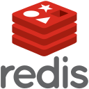
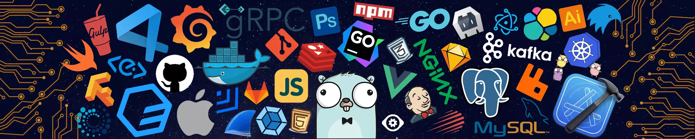

<h1 align="center">Hi, I'm Rajesh Ranjan 👋</h1>

    
  

  <b>Full Stack Developer @ Business Today Technology (India Today Group)</b> 
  6+ years building scalable, high-performance web applications with React, Next.js, Node.js and TypeScript

  
  
  
  
  

<h1 align="center">🧠 About</h1>

I design and build production-grade web platforms with a focus on performance, scalability and developer experience. Currently I work on high-traffic media platforms at India Today Group, covering frontend architecture, AI-powered content pipelines, SEO / Core Web Vitals and AWS-based deployments.

<h1 align="center">🔧 Tech Stack</h1>

  
  
  
  
  
  
  
  
  
  
  
  
  
  
  
  
  
  
  

<h1 align="center">💼 Professional Experience</h1>

👨‍💻 **Full Stack Developer — Business Today Technology (India Today Group)** · _Apr 2025 – Present_

- Re-architected distributed Python services into a unified Next.js system, reducing infrastructure complexity.
- Built AI-powered content analysis pipelines (OpenAI APIs, NLP) processing 500,000+ news articles.
- Cut page render time from 3.7s to 1.5s through SSR, caching and Core Web Vitals optimization.
- Reduced unnecessary API traffic by 40%+ and led the Next.js 12 → 15 migration, resolving security vulnerabilities.

👨‍💻 **UI Developer — NTT DATA Services** · _Nov 2020 – Apr 2025_

- Built reusable React component libraries and frontend modules for enterprise Banking and Education applications.
- Delivered analytics dashboards with Highcharts-based interactive reporting.
- Improved performance by replacing heavy third-party UI libraries with lightweight custom components.

<h1 align="center">📈 Developer Dashboard</h1>

  
  
     •  • 
     
  

  

    
  

    
    
    
  

  

    
  

  

    
    
  

  

    
    
  

  

    
  

<h1 align="center">🔧 Gears Behind the Code</h1>

### 💻 Languages & Core

![Java](https://img.shields.io/badge/java-FFFFFF.svg?style=for-the-badge&logo=&logoColor=white)

### 🎨 Frontend Mastery

![CSS](https://img.shields.io/badge/css-0277BD.svg?style=for-the-badge&logo=&logoColor=white)

### ⚙️ Backend & Infrastructure

![Java](https://img.shields.io/badge/java-FFFFFF.svg?style=for-the-badge&logo=&logoColor=white)

### 🗄️ Databases

![Oracle](https://img.shields.io/badge/oracle-FF0000.svg?style=for-the-badge&logo=&logoColor=white)

### ☁️ DevOps & Cloud

  <h1 align="center">💡 Development Philosophy</h1>

_"Any fool can write code that a computer can understand. Good programmers write code that humans can understand."_

  <h1 align="center">🧭 Contributor Stats</h1>

  

    
  

  <h1 align="center">🐍 Activity Anaconda</h1>

  <picture>
    <source media="(prefers-color-scheme: dark)" srcset="/snake-commit-contribution/github-snake-dark.svg" />
    <source media="(prefers-color-scheme: light)" srcset="/snake-commit-contribution/github-snake.svg" />
    
  </picture>

  <h1 align="center">😂 Here is a random joke that'll make you laugh!</h1>

  

    
  

  <h1 align="center">
    🛸 Beam Me a Message
    
  </h1>

  

     
    <a href="https://github.com/rajesh-ranjan-git/" target="_blank">
      <code></code>
    </a>
    <a href="https://linkedin.com/in/rajesh-ranjan-660b1b13a/" target="_blank">
      <code></code>
    </a>
    <a href="https://twitter.com/_rajesh____/" target="_blank">
      <code></code>
    </a>
    <a href="https://www.instagram.com/_rajesh____/" target="_blank">
      <code></code>
    </a>
    <a href="https://fb.com/rajeshranjan8271/" target="_blank">
      <code></code>
    </a>
    <a href="mailto:rajeshranjan8271@gmail.com/">
      <code></code>
    </a>
  

### 🚀 "Code, Create, Contribute."

**Shaping the future — one commit at a time! ⭐**

### Thanks for stopping by! Show some ❤️ by starring some of my repositories!

#

